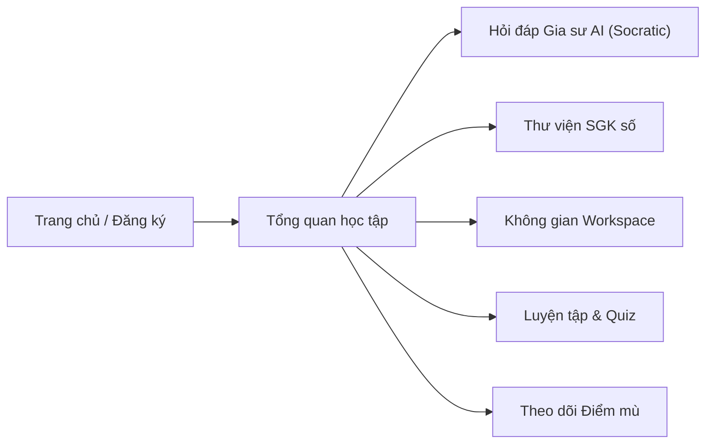
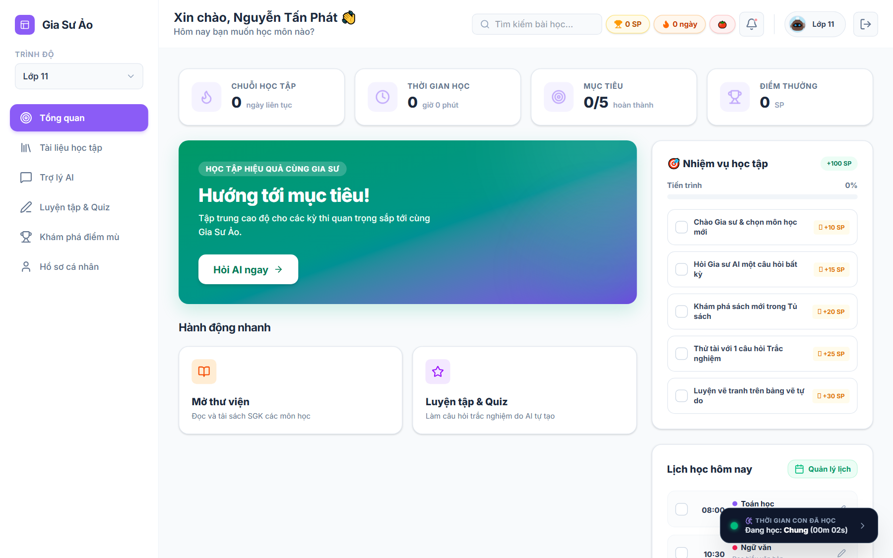
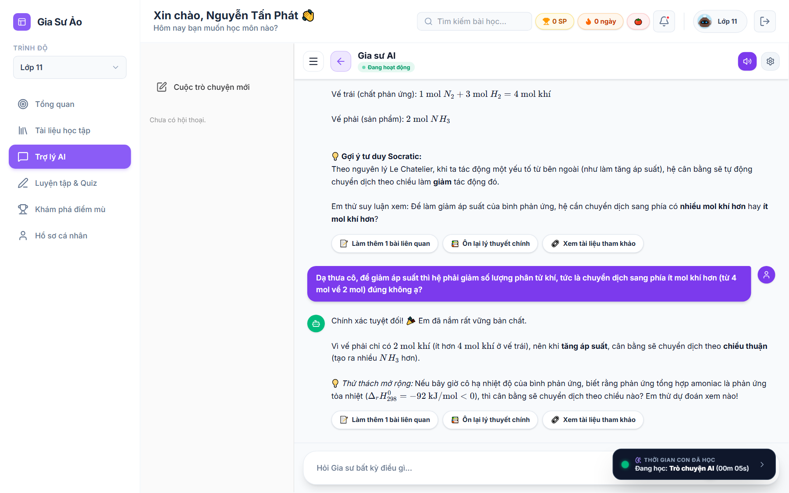
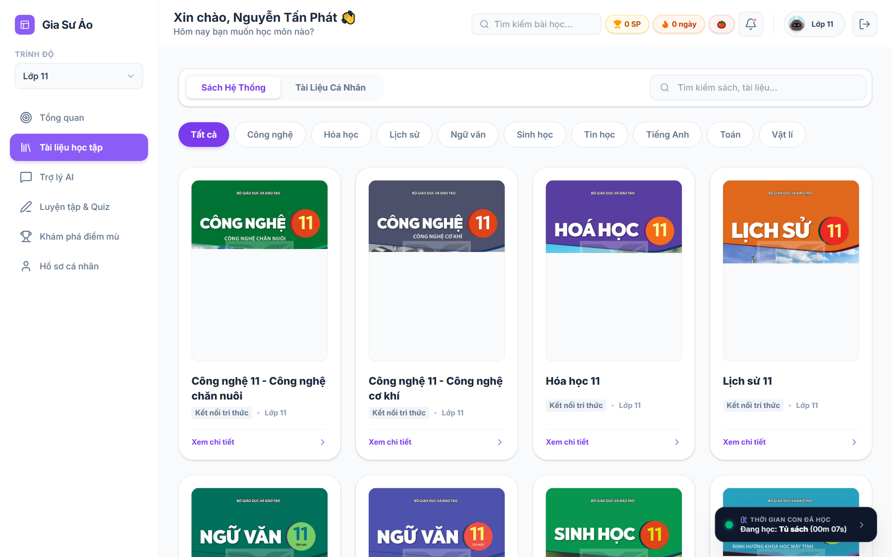
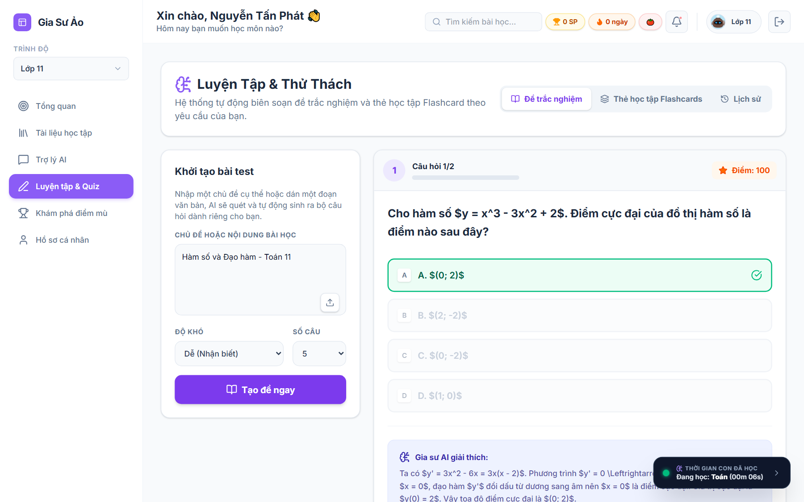
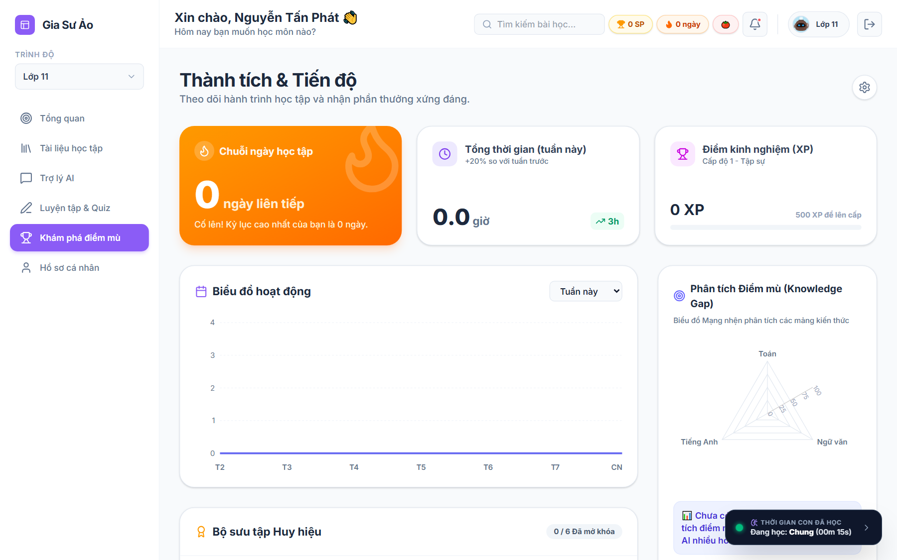
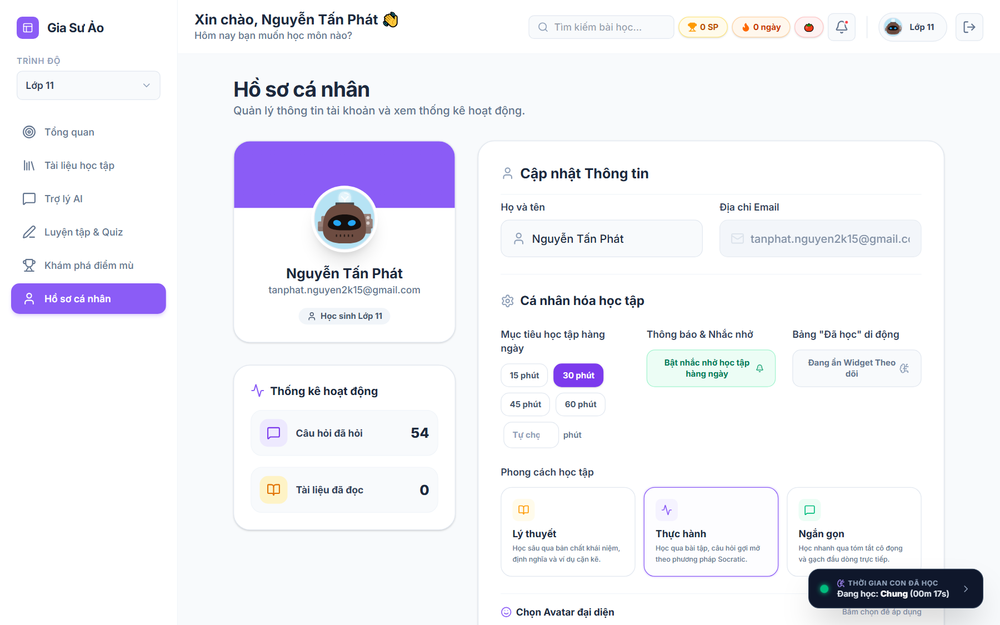
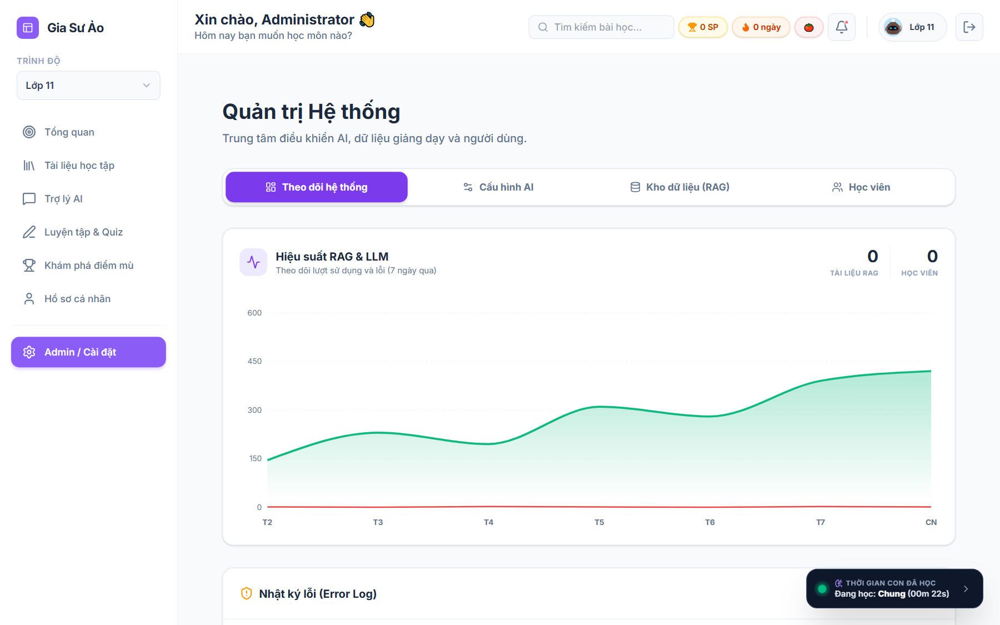

# 📘 SỔ TAY HƯỚNG DẪN SỬ DỤNG HỆ THỐNG GIA SƯ ẢO
*(Hệ thống Gia sư Thông minh theo Phương pháp Socratic & RAG SGK GDPT 2018)*

---

## LỜI NÓI ĐẦU
Chào mừng các bạn học sinh, quý thầy cô giáo và phụ huynh đến với **Gia Sư Ảo**!

Cuốn sổ tay này được biên soạn nhằm hướng dẫn chi tiết từng bước cách sử dụng các tính năng hiện có trên website. Toàn bộ hình ảnh minh họa trong tài liệu đều là **ảnh chụp màn hình thực tế từ chính hệ thống đang hoạt động**, mô tả chính xác những gì trang web cung cấp mà không cường điệu hay phóng đại.

---

## CHƯƠNG 1: TRANG CHỦ & ĐĂNG NHẬP / ĐĂNG KÝ

### 1.1. Trang chủ giới thiệu (Landing Page)
Khi truy cập vào website, bạn sẽ được đón tiếp bởi giao diện trang chủ thân thiện với đầy đủ thông tin định hướng học tập.

* **Nút "Bắt đầu học ngay":** Mở màn hình đăng nhập hoặc đăng ký tài khoản học sinh.
* **Nút "Học thử 30 phút" (Trải nghiệm khách):** Cho phép học sinh hoặc khách vãng lai trải nghiệm ngay các tính năng hỏi đáp và đọc sách mà không bắt buộc tạo tài khoản ngay lập tức.
* **Các thẻ giới thiệu phương pháp:** Tóm tắt 3 trụ cột của hệ thống: *Phương pháp gợi mở Socratic*, *Kho dữ liệu SGK chuẩn GDPT 2018*, và *Không gian học tập tích hợp đa nhiệm*.

---

### 1.2. Đăng ký & Đăng nhập tài khoản
Hệ thống hỗ trợ quản lý tài khoản theo khối lớp để cá nhân hóa toàn bộ nội dung SGK và độ khó câu hỏi.

#### Các bước đăng ký / đăng nhập:
1. **Chọn Khối lớp học tập:** Nhấp chọn khối lớp của em (từ **Lớp 1 đến Lớp 12**). Giao diện sẽ tự động đổi màu sắc và phong cách ngôn ngữ phù hợp với cấp học (Tiểu học / THCS / THPT).
2. **Nhập thông tin:**
   * **Họ và tên:** Nhập tên của em để Gia sư xưng hô thân mật.
   * **Email:** Điền địa chỉ email (ví dụ: `nguyenvana@gmail.com`).
   * **Mật khẩu:** Thiết lập mật khẩu bảo vệ tài khoản (tối thiểu 6 ký tự).
3. **Đăng nhập:** Nhấn **"Đăng nhập"** để lưu phiên làm việc và vào thẳng bảng điều khiển cá nhân.

---

## CHƯƠNG 2: MÀN HÌNH TỔNG QUAN (DASHBOARD OVERVIEW)

Sau khi đăng nhập, hệ thống sẽ đưa bạn vào màn hình **Tổng quan**, nơi tổng hợp toàn bộ trạng thái học tập của bạn trong ngày.

### Các thành phần chính trên màn hình Tổng quan:
1. **Thanh 4 chỉ số cốt lõi (Top Stat Cards):**
   * 🔥 **Chuỗi học tập (Streak):** Số ngày liên tục bạn duy trì vào học.
   * ⏱️ **Thời gian học:** Tổng thời lượng tự học tích lũy thực tế trong ngày thông qua bộ đếm song song.
   * 🎯 **Mục tiêu:** Tỷ lệ hoàn thành nhiệm vụ đặt ra trong ngày (ví dụ $0/5$ nhiệm vụ).
   * 🏆 **Điểm thưởng (SP - Study Points):** Điểm tích lũy khi hoàn thành các câu hỏi trắc nghiệm và phiên học.
2. **Banner "Hướng tới mục tiêu":** Cung cấp nút bấm nhanh **"Hỏi AI ngay $\rightarrow$"** để mở phiên hỏi đáp bài tập tức thì.
3. **Danh mục Hành động nhanh:** Truy cập 1 chạm tới **Mở thư viện** (SGK) hoặc **Luyện tập & Quiz**.
4. **Cột Nhiệm vụ học tập (Bên phải):** Danh sách các thử thách nhỏ như: *Chào Gia sư & chọn môn mới (+10 SP)*, *Hỏi Gia sư một câu hỏi bất kỳ (+15 SP)*, *Khám phá sách mới (+20 SP)*...
5. **Widget Theo dõi thời gian học thực tế (Góc dưới phải):** Hiển thị trực tiếp thời gian em đang tập trung vào môn học nào (ví dụ: *Đang học: Trò chuyện AI (00m 05s)*).

---

## CHƯƠNG 3: TRỢ LÝ AI - GIA SƯ SOCRATIC (HỎI ĐÁP & HỌC TẬP)

Đây là tính năng trọng tâm của hệ thống. Gia Sư AI không giải hộ bài tập mà sử dụng **phương pháp Socratic (Scaffolding)** để đặt câu hỏi gợi mở, giúp học sinh tự tìm ra đáp án đúng.

### 3.1. Các nhóm môn học được hỗ trợ
Hệ thống phân loại môn học theo cấu trúc chương trình GDPT 2018:
* **Nhóm bắt buộc (Cốt lõi):** Toán học, Ngữ văn, Tiếng Anh, Lịch sử.
* **Nhóm Tự nhiên (Khối A, B):** Vật lí, Hóa học, Sinh học, Tin học.
* **Nhóm Xã hội (Khối C, D):** Địa lí, Giáo dục kinh tế và pháp luật.

### 3.2. Quy trình tương tác Socratic
1. **Đặt câu hỏi:** Em có thể gõ câu hỏi bất kỳ, dán bài tập hoặc đặt vấn đề cần giải thích vào khung nhập tin nhắn phía dưới.
2. **Hiển thị công thức khoa học (KaTeX):** Hệ thống tự động biên dịch ký hiệu toán học và hóa học chuẩn xác (ví dụ phản ứng thuận nghịch $N_2(k) + 3H_2(k) \rightleftharpoons 2NH_3(k)$, nhiệt phản ứng $\Delta_r H_{298}^0 = -92\text{ kJ/mol}$, các phương trình bậc hai, tích phân...).
3. **Nhận gợi ý tư duy:** Gia sư AI sẽ phân tích đề bài, trích xuất dữ kiện quan trọng và đặt câu hỏi định hướng tư duy (Ví dụ: *"Theo nguyên lý Le Chatelier, để giảm áp suất hệ sẽ chuyển dịch về phía nhiều mol khí hơn hay ít mol khí hơn?"*).
4. **Học sinh phản hồi & nhận xét:** Học sinh trả lời suy đoán của mình. Nếu đúng, AI sẽ chúc mừng, tổng kết bản chất lý thuyết và đưa thêm câu hỏi mở rộng nhằm khắc sâu kiến thức.
5. **Các nút gợi ý thông minh:** Dưới mỗi câu trả lời có sẵn các nút hành động:
   * 📝 *Làm thêm 1 bài liên quan*
   * 📚 *Ôn lại lý thuyết chính*
   * 🔗 *Xem tài liệu tham khảo*
6. **Hỗ trợ âm thanh (TTS):** Nút biểu tượng chiếc loa ở góc trên bên phải cho phép bật/tắt tính năng đọc câu trả lời bằng giọng nói tiếng Việt chuẩn.

---

## CHƯƠNG 4: THƯ VIỆN SGK SỐ HÓA (DIGITAL LIBRARY)

Thư viện số hóa lưu trữ toàn bộ các đầu sách giáo khoa theo chuẩn Chương trình GDPT 2018 mới nhất của Bộ GD&ĐT (Kết nối tri thức, Chân trời sáng tạo, Cánh diều).

### Cách sử dụng Thư viện:
1. **Lọc theo môn học:** Chọn các thẻ bộ môn ở thanh ngang: *Tất cả, Toán, Ngữ văn, Tiếng Anh, Vật lí, Hóa học, Lịch sử, Sinh học, Tin học, Công nghệ...*
2. **Tìm kiếm:** Nhập tên cuốn sách hoặc chuyên đề vào ô tìm kiếm ở góc trên.
3. **Chuyển đổi nguồn tài liệu:**
   * **Sách Hệ Thống:** Các đầu sách giáo khoa chuẩn mực do ban quản trị cập nhật sẵn.
   * **Tài Liệu Cá Nhân:** Nơi học sinh có thể tự tải lên tài liệu học tập cá nhân (PDF, ảnh bài tập).
4. **Xem chi tiết & Đọc sách:** Nhấp chuột vào bất kỳ bìa sách nào để xem thông tin số trang, mục lục các chương và nhấn **"Đọc sách trực tuyến"** để chuyển sang Không gian học tập Workspace.

---

## CHƯƠNG 5: KHÔNG GIAN HỌC TẬP TÍCH HỢP (WORKSPACE)

**Workspace** là không gian làm việc chia đôi màn hình (Split-screen), cho phép học sinh vừa đọc tài liệu vừa có Gia sư AI đồng hành trực tiếp cùng đồng hồ Pomodoro.

### Các tính năng đặc sắc trong Workspace:
* **Cột trái (Vùng đọc tài liệu):** Hiển thị toàn văn nội dung sách giáo khoa hoặc tài liệu học tập được chọn.
* **Cột phải (Trợ lý AI bám sát tài liệu):** AI tự động tải ngữ cảnh cuốn sách đang đọc để giải đáp thắc mắc ngay tại chỗ mà không cần chuyển qua lại giữa các tab trình duyệt.
* **Đồng hồ đếm ngược Pomodoro (25:00):** Tích hợp trên thanh tiêu đề, giúp học sinh rèn luyện thói quen tự học kỷ luật (25 phút tập trung cao độ, 5 phút nghỉ ngơi).
* **Nút tác vụ nhanh theo tài liệu:**
  * 📋 *Liệt kê các ý chính trong tệp này*
  * 📅 *Tạo kế hoạch học tập cho tệp này*
  * 📖 *Tóm tắt nội dung sách*
  * 🔊 *Nghe đọc / Giải thích đơn giản hơn*
* **Chế độ Toàn màn hình (Fullscreen):** Nhấn biểu tượng mũi tên 4 hướng để mở rộng tối đa không gian học tập.

---

## CHƯƠNG 6: LUYỆN TẬP & THỬ THÁCH (QUIZ & FLASHCARDS)

Module Luyện tập giúp học sinh củng cố kiến thức thông qua các câu hỏi trắc nghiệm tự động biên soạn chuẩn hóa theo từng bài học.

### Các bước làm bài luyện tập:
1. **Khởi tạo bài test (Cột trái):**
   * Nhập **Chủ đề hoặc nội dung bài học** (ví dụ: *Hàm số và Đạo hàm - Toán 11*).
   * Chọn **Độ khó:** Dễ (Nhận biết), Trung bình (Thông hiểu), hoặc Vận dụng / Vận dụng cao.
   * Chọn **Số lượng câu:** 5 câu, 10 câu hoặc 15 câu.
   * Nhấn **"Tạo đề ngay"**.
2. **Thực hiện bài thi (Cột phải):**
   * Đọc câu hỏi với công thức toán học KaTeX rõ ràng.
   * Bấm chọn một trong bốn phương án (A, B, C, D).
3. **Phản hồi tức thì & Lời giải chi tiết:**
   * Hệ thống hiển thị ngay viền xanh kèm dấu tích $\checkmark$ cho phương án đúng, hoặc cảnh báo nếu chọn sai.
   * Phần **"Gia sư AI giải thích"** phía dưới trình bày chi tiết từng bước áp dụng công thức, các bước biến đổi trung gian và kết luận cuối cùng.
4. **Chế độ Thẻ học tập Flashcards:** Nhấp tab *Thẻ học tập Flashcards* ở góc trên để ôn nhanh các định nghĩa và công thức then chốt.

---

## CHƯƠNG 7: THEO DÕI TIẾN ĐỘ & PHÂN TÍCH ĐIỂM MÙ (PROGRESS & BLIND SPOTS)

Hệ thống ghi nhận toàn diện nhật ký học tập của học sinh để trực quan hóa hành trình tiến bộ.

### Các thông số đo lường:
1. **Chuỗi ngày học liên tiếp:** Thúc đẩy thói quen tự học hàng ngày.
2. **Tổng thời gian học (tuần này):** Thống kê số giờ học thực tế và so sánh mức tăng giảm phần trăm so với tuần trước.
3. **Điểm kinh nghiệm (XP):** Tích lũy điểm khi hoàn thành các phiên học để thăng cấp học sinh (Tập sự $\rightarrow$ Chăm chỉ $\rightarrow$ Xuất sắc).
4. **Biểu đồ hoạt động theo tuần:** Trục tọa độ hiển thị số giờ học tập từ Thứ 2 đến Chủ nhật.
5. **Biểu đồ mạng nhện phân tích Điểm mù (Knowledge Gap Radar):** Trực quan hóa độ nắm vững kiến thức đa môn (Toán, Ngữ văn, Tiếng Anh...). Vùng biểu đồ nào bị lõm vào sẽ là tín hiệu để học sinh biết mình cần tập trung ôn luyện thêm môn đó.
6. **Bộ sưu tập Huy hiệu:** Vinh danh các cột mốc quan trọng (Ví dụ: *Học sinh chăm chỉ, Vua giải đố, Cú đêm học tập...*).

---

## CHƯƠNG 8: HỒ SƠ CÁ NHÂN & CÀI ĐẶT (PROFILE)

Trang Hồ sơ cá nhân cho phép người học xem và tùy chỉnh các thiết lập tài khoản.

### Các tùy chọn chính:
* **Thông tin tài khoản:** Hiển thị Tên học sinh, Email đăng ký, và Khối lớp hiện tại.
* **Thay đổi khối lớp:** Cho phép học sinh linh hoạt đổi lớp (từ Lớp 1 đến Lớp 12) khi bắt đầu năm học mới.
* **Mục tiêu học tập hàng ngày:** Đặt mục tiêu số phút tự học mỗi ngày (ví dụ: 30 phút, 45 phút, 60 phút) để hệ thống nhắc nhở.
* **Đăng xuất:** Nút đăng xuất bảo đảm an toàn dữ liệu khi dùng chung thiết bị tại trường hoặc phòng máy.

---

## CHƯƠNG 9: BẢNG ĐIỀU KHIỂN QUẢN TRỊ VIÊN (ADMIN PANEL)

*(Chỉ hiển thị đối với tài khoản có quyền Quản trị viên - Admin)*

### Chức năng dành cho Quản trị viên:
1. **Theo dõi hệ thống:**
   * Thống kê tổng số lượng **Tài liệu RAG** đã nạp vào cơ sở dữ liệu tri thức (hiện có 130 tài liệu).
   * Thống kê tổng số lượng **Học viên** đăng ký trên hệ thống (129 học viên).
   * Biểu đồ đường hiển thị hiệu suất và lưu lượng hỏi đáp trong 7 ngày qua.
2. **Cấu hình AI:** Kiểm soát tham số prompt hệ thống, nhiệt độ sinh câu trả lời (temperature) và cơ chế định tuyến (Query Routing).
3. **Kho dữ liệu (RAG):** Quản lý các tập tin văn bản, tài liệu SGK và các đoạn trích dữ liệu vector (chunks).
4. **Học viên:** Quản lý danh sách học sinh, phân loại khối lớp và theo dõi trạng thái tài khoản.
5. **Nhật ký lỗi (Error Log):** Theo dõi các lỗi phát sinh (UploadFailed, Timeout...) để kịp thời xử lý kỹ thuật.

---

## BẢNG TỔNG HỢP MẸO HỌC TẬP HIỆU QUẢ CÙNG GIA SƯ ẢO

| Mẹo / Thao tác | Mô tả chi tiết |
| :--- | :--- |
| **Gõ công thức Toán / Hóa** | Sử dụng cú pháp LaTeX kẹp giữa dấu `$` (ví dụ `$x^2 - 4x + 3 = 0$` hoặc `$\\Delta_r H^0$`), hệ thống sẽ hiển thị công thức đẹp mắt. |
| **Khai thác gợi ý Socratic** | Không nên chỉ hỏi "Đáp án bài này là gì?", hãy hỏi "Bước đầu tiên làm bài này như thế nào?" hoặc "Công thức áp dụng cho bài này là gì?" để AI hướng dẫn tư duy sâu nhất. |
| **Sử dụng Pomodoro** | Bật đồng hồ 25 phút trong Workspace để giữ sự tập trung tuyệt đối, tránh xao nhãng khi học bài online. |
| **Kiểm tra Điểm mù định kỳ** | Mỗi cuối tuần, hãy ghé tab *Khám phá điểm mù* để xem môn học nào đang có điểm yếu và nhờ Gia sư AI sinh thêm 1 bài Quiz về phần đó. |

---
*© 2026 Dự án Nghiên cứu Khoa học Kỹ thuật - Nền tảng Gia Sư Ảo AI Socratic RAG.*
